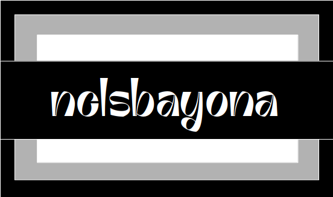

  

<h2 align="center">👋 Hey there 👋</h2>

<!--p  align="center">

</p-->

  

----

Maybe you're looking for a drink? 🍹

 
<h4 align="center">Snake Bite (UK)</h4>

<h5 align="center">Alcoholic - Beer</h5>

<h5 align="center">Necessary ingredients</h5>
<table align="center">
<tr>
<td>
<table frame="box" rules="cols">
    <thead>
        <tr>
            <th style="padding-left: 1em; padding-right: 1em; text-align: center">Ingredient</th>
            <th style="padding-left: 1em; padding-right: 1em; text-align: center">Measure</th>
        </tr>
    </thead>
    <tbody>
        <tr>
            <td style="padding-left: 1em; padding-right: 1em; text-align: center; vertical-align: top">Lager</td>
            <td style="padding-left: 1em; padding-right: 1em; text-align: center; vertical-align: top">1/2 pint </td>
        </tr>
        <tr>
            <td style="padding-left: 1em; padding-right: 1em; text-align: center; vertical-align: top">Cider</td>
            <td style="padding-left: 1em; padding-right: 1em; text-align: center; vertical-align: top">1/2 pint sweet or dry </td>
        </tr>
    </tbody>
</table>
</td>
</tr>
</table>

Pour ingredients into a pint glass. Drink. Fall over.

----

Maybe you're interested in learning more about my profile? 🪂

 
<h5 align="center">👀 Visitor count</h5>

----

Maybe you're interested in checking out my stats? 🐣

 
<h4 align="center">General GitHub Stats 🌀</h4>

<!--h5>😃 General Overview</h5-->

<!--h5>Life-Time Stats Overview 😃</h5-->

 

<h4 align="center">🤖 Programming Languages Stats</h4>

<!--h5>Most Used Languages Stats 💾</h5-->

 

<h4 align="center">⌚General Weekly-Stats</h4>
<table align="center">
<tr>
<td>
<table frame="box" rules="cols">
    <thead>
        <tr>
            <th style="padding-left: 1em; padding-right: 1em; text-align: center">Language name</th>
            <th style="padding-left: 1em; padding-right: 1em; text-align: center">Time spent</th>
        </tr>
    </thead>
    <tbody>
    </tbody>
</table>
</td>
<td>
<table frame="box" rules="cols">
    <thead>
        <tr>
            <th style="padding-left: 1em; padding-right: 1em; text-align: center">OS name</th>
            <th style="padding-left: 1em; padding-right: 1em; text-align: center">Time spent</th>
        </tr>
    </thead>
    <tbody>
    </tbody>
</table>
</td>
</tr>
</table>

----

Maybe you're looking to see something about our universe? 🔭

 
<h4 align="center">NASA Science - ©️ NASA @ 2026-10-18</h4>

<h5 align="center">Yes, but have you ever experienced the Eagle Nebula with your ears? The famous nebula M16 is best known for the feast it gives your eyes, highlighting bright young stars forming deep inside dark towering structures. These light-years long columns of cold gas and dust are some 6,500 light-years distant toward the constellation of the Serpent (Serpens). Sculpted and eroded by the energetic ultraviolet light and powerful winds from M16's cluster of massive stars, the cosmic pillars themselves are destined for destruction. But the turbulent environment of star formation within M16, whose spectacular details are captured in this combined Hubble (visible) and Chandra (X-ray) image, is likely similar to the environment that formed our own Sun. In the featured video, listen for stars and dust sounding off as the line of sonification moves left to right, with vertical position determining pitch.Tomorrow's picture: what could it be?						</h5>

----

Maybe you're looking for some cool animal pictures? 👁️

 
<table align="center">
<tr>
<td>

</td>
<td>

</td>
<td>

</td>
</tr>
<tr>
<td>

</td>
<td>

</td>
<td>

</td>
</tr>
<tr>
<td>

</td>
<td>

</td>
<td>

</td>
</tr>
<tr>
<td>

</td>
<td>

</td>
<td>

</td>
</tr>
<tr>
<td>

</td>
<td>

</td>
<td>

</td>
</tr>
<tr>
<td>

</td>
<td>

</td>
<td>

</td>
</tr>
<tr>
<td>

</td>
<td>

</td>
<td>

</td>
</tr>
<tr>
<td>

</td>
<td>

</td>
<td>

</td>
</tr>
</table>

----

Maybe you're interested in checking out my latest content? 🐣

 

[Platform Engineering: From DevOps Principles to Internal Developer Platforms](https://nclsbayona.github.io/p/platform-engineering/)
> Mon, 13 Jul 2026 12:00:00 +0000

[Cloud-Native Lessons for AI: Applying Kubernetes Practices to Intelligent Systems](https://nclsbayona.github.io/p/cloud-native-lessons-ai-kubernetes/)
> Sat, 09 May 2026 13:14:26 +0000

[Connectivity at different layers](https://nclsbayona.github.io/p/connectivity-networking/)
> Sat, 03 Jan 2026 02:00:00 +0000

[Talos OS deployment](https://nclsbayona.github.io/p/kubernetes-talos/)
> Wed, 24 Dec 2025 08:00:00 +0000

[Deployment of secure webpages](https://nclsbayona.github.io/p/deployment-secure-webpages/)
> Mon, 31 Mar 2025 08:00:00 +0000

----

----

<h3 align="center">Contact me! 📇</h3>

<!-- 

 !-->

 

<h3 align="center">Visit my webpage 🛸</h3>

